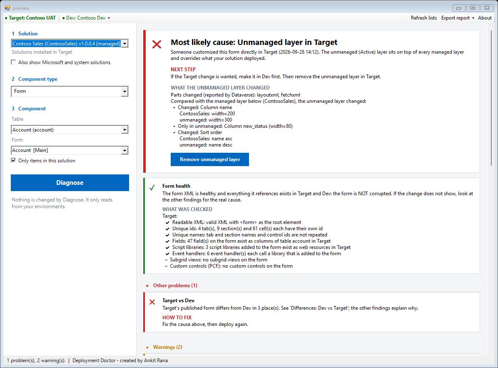
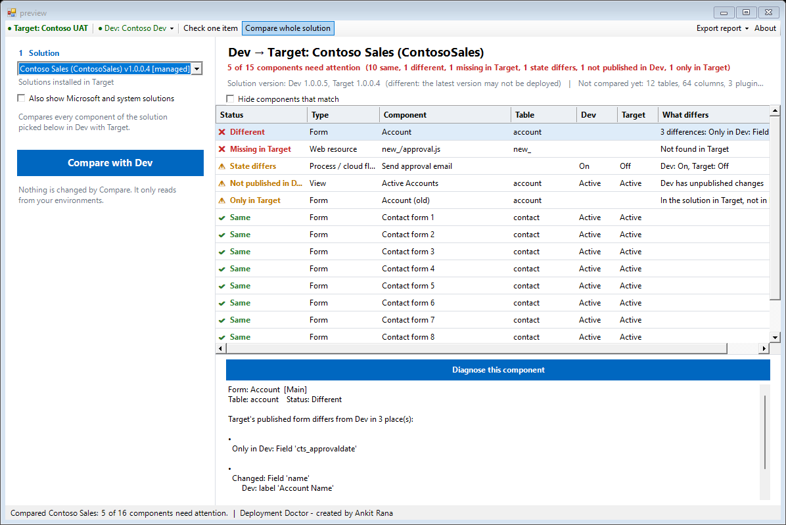

  

<h1 align="center">Deployment Doctor</h1>

  An <a href="https://www.xrmtoolbox.com/">XrmToolBox</a> tool that answers the classic ALM question: <b>"I deployed the managed solution. Why doesn't my change show?"</b> 
  Check <b>one component</b> and get the cause and the fix, or <b>compare a whole solution</b> between Dev and Target in one go.

  
  
  
  

   
  <i>Sample data (a fictitious "Contoso" environment).</i>

---

## Why

A change made in Dev and shipped in a managed solution can fail to appear in UAT or Prod for many reasons. Each one is checked in a different screen, and some aren't visible anywhere:

| Cause | Applies to | What you see |
|---|---|---|
| Changes not published in Dev before export | forms, views, web resources | The package simply doesn't contain them |
| Component not in the solution (table added without it) | all | Import succeeds, nothing changes |
| Unmanaged (Active) layer in Target | all | Someone edited it in Target; it overrides your deployment |
| Another managed solution installed above yours | all | Its version wins |
| Staged upgrade never applied / imported as Update | all | Removed items are still there |
| Flow or workflow turned off after import, connection reference without a connection | processes, connection references | Nothing runs |
| Environment variable with no value in Target | environment variables | Flows and apps read nothing |
| Plug-in step disabled, or an older assembly version in Target | plug-in steps, assemblies | The server logic never runs, or runs the old code |
| Old copy with the same name still on | processes | The old behaviour keeps happening |
| Form or view inactive, missing from the app, not the default; form roles or order | forms, views | Users simply open a different one |
| Script not used by any form; browser cache | web resources | The new code never runs |
| Form XML damaged, or pointing at fields, scripts or views that don't exist | forms, site maps, ribbons | "The form is corrupted" |

**Deployment Doctor checks all of them in one click**, shows the evidence (solution layers and a readable Dev vs Target comparison), names the most likely cause and tells you how to fix it.

## Two ways to use it

### 1. Check one item

Pick the solution, the component type and the component, click **Diagnose**, and read the answer: the most likely cause, what to do next, and every check behind it.

### 2. Compare whole solution

Click **Compare whole solution** in the toolbar, pick the solution you deployed and click **Compare with Dev**. Every component of the solution is found in Target and compared with Dev:

- 🔴 **Different** or **missing in Target**: the change did not arrive
- 🟠 **State differs** (for example a flow on in Dev but off in Target, or "No connection" / "No value" in Target), **not published in Dev**, or **only in Target** (removed in Dev, still in Target)
- 🟢 **Same**

Click a row for the exact differences, then **Diagnose this component** for the cause and the fix. Export the result as HTML, CSV or text.

   
  <i>Sample data.</i>

## What it can check

| Component | Compared and checked |
|---|---|
| **Form** | tabs, sections, fields, field order, labels, visibility, scripts, event handlers; active, in the apps, security roles, form order; **form health** (really corrupted, or only broken references?); recreated forms with the same name |
| **View** | columns and widths, column order, filters, sort order, related tables; active, default view, in the apps |
| **Site map** | areas, groups and sub areas (title, table, URL, icon, privilege, order); **site map health**; which apps use it |
| **Ribbon (command bar)** | buttons added or hidden, commands and the scripts they run, rules, labels; **ribbon health** |
| **Process / cloud flow** | workflow definition lines; flow triggers, steps and connection references; turned on or off; old copies with the same name |
| **Environment variable** | type and default value; whether Target has any value (the current value is shown, not compared: it differs per environment by design) |
| **Connection reference** | connector; whether it has a connection in Target |
| **Plug-in step** | message, stage, mode, order, plug-in class and assembly version, filtering columns; enabled or disabled (with a confirmed **Enable** fix) |
| **Plug-in assembly** | version, isolation mode, the DLL itself (size and hash) |
| **Web resource** | changed lines (JS, HTML, CSS, XML, SVG, RESX), size and hash for images; which forms use it |

## Features

- **Two environments**: Target (where the change doesn't show) as the main connection, Dev (source) as a second connection
- **Verdict first**: "Most likely cause: ..." at the top, with every check listed below as Problem / Warning / OK / Info
- **"Is it really corrupted?"**: a health check for forms, site maps and ribbons, with a **What was checked** list (readable XML, unique ids, fields, scripts, handlers, views ...) so you can show a developer exactly what was looked at
- **Solution layers** of the component in Target, with your solution, layers above it and the unmanaged layer highlighted
- **What the unmanaged layer changed**, when it was **last changed** (your local time) and whether that is older or newer than your last deployment
- **Evidence in plain words** (User view) or the full detail (Developer view)
- **Confirmed fixes**: remove the unmanaged layer in Target, publish in Dev, add to the Dev solution, turn a flow or workflow on in Target, enable a plug-in step in Target. Each one shows exactly what changes, and where, before it runs
- **Export report** as HTML (email or ticket), CSV (Excel) or text (Teams). Form XML and environment URLs are left out unless you tick them. See the [sample report](docs/sample-report.html)

## What it does not do (yet)

- It never changes anything by itself: only a Fix button changes something, and only after you confirm.
- **Compare whole solution** compares forms, views, site maps, ribbons, processes / flows, environment variables, connection references, plug-in steps, plug-in assemblies and web resources. Tables, columns, choices, security roles, model-driven apps and dashboards are only counted in the header.
- It compares the **published** content, not unpublished work in progress (it tells you when Dev has unpublished changes).
- It cannot remove the unmanaged layer of a ribbon, environment variable, connection reference or plug-in; it shows the manual steps.
- It cannot tell for sure who made an unmanaged change or when it was first added: Dataverse keeps only the time of the last change of a layer.

## Install

In XrmToolBox, open **Tool Library**, search for **Deployment Doctor**, and click **Install**.

## How to use

1. Connect XrmToolBox to the **Target** environment (UAT/Prod) and open **Deployment Doctor**.
2. Click **Connect Dev (source)...** in the **Dev** menu and pick your Dev connection (needed for Compare whole solution, and it enables the most useful checks for one item).
3. **Check one item**: pick the **solution** (installed in Target), the **component type**, the table (or prefix) and the component, then click **Diagnose**. Read the verdict, then the findings. Use a **Fix** button if one is offered.
   **Compare whole solution**: pick the solution and click **Compare with Dev**. Click a row for details.
4. Click **Export report** to share the result as HTML, CSV or text.

The start screen inside the tool lists what it can check and what it cannot do, and is kept in step with this page.

## How it works

**User guide** (step by step, with screenshots): [Word](docs/Deployment-Doctor-User-Guide.docx) · [PDF](docs/Deployment-Doctor-User-Guide.pdf). For developers: [docs/how-it-works.md](docs/how-it-works.md). Changes between versions are in the [changelog](CHANGELOG.md).

## Feedback

[Open an issue](https://github.com/ankitrana/XrmToolBox/issues/new/choose) and pick **Deployment Doctor**.

## Author

Created by **Ankit Rana**, Dynamics 365 / Power Platform Solutions Architect. [LinkedIn](https://www.linkedin.com/in/mrankitrana/) · [GitHub](https://github.com/ankitrana)

MIT licensed.
